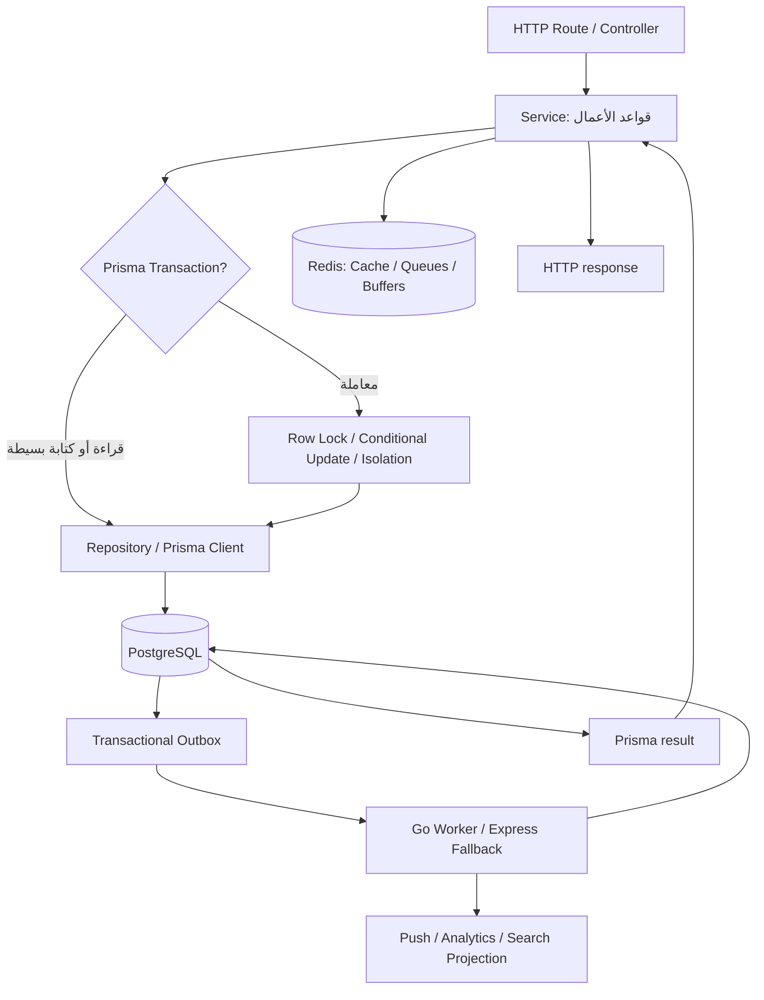
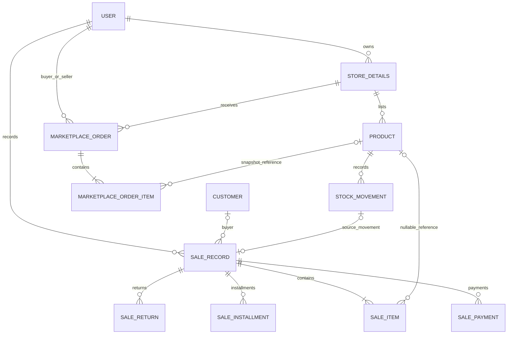
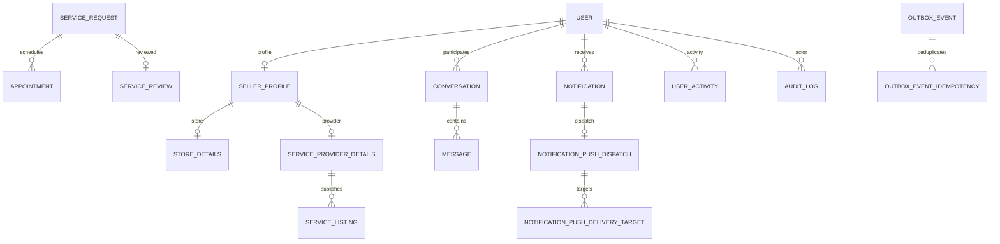

# تقرير التدقيق العميق لقاعدة بيانات MarketPlat

**التاريخ:** 9 نوفمبر 2026  
**النطاق:** `apps/api/prisma/schema.prisma`، جميع ترحيلات Prisma، مستودعات واستعلامات البيانات في `apps/api/src`، ومعالجة المهام والتحليلات ذات الصلة في `apps/go-worker`.  
**نوع التدقيق:** تحليل مصدر ومراجعة ساكنة للمخطط والاستعلامات والترحيلات. لم يتم الاتصال بقاعدة إنتاج أو تنفيذ DDL عليها.

## 1. الخلاصة التنفيذية

| المؤشر | النتيجة |
|---|---:|
| Prisma Models | 75 |
| Prisma Enums | 45 |
| حقول Decimal | 86 |
| حقول Float | 0 |
| حقول JSON | 28 |
| تصريحات `@@index` قبل التعديل | 155 |
| تصريحات `@@unique` | 24 |
| تصريحات الحقول `@unique` | 55 |
| مجلدات Migrations الأصلية | 120 |
| Migrations أصلية مفقودة أو معدلة | 0 |
| Migration جديدة | 1 |
| اختبارات PostgreSQL/Prisma فعلية منفذة | 0 — لا توجد بيئة DB/Prisma CLI في جلسة التدقيق |

**القرار:** تصميم البيانات يحتوي على جوانب جيدة وواضحة في فصل الطلبات عن سجل مبيعات البائع، واستخدام Decimal للأموال، وفرض مفاتيح فريدة لعقود idempotency، وتأمين حركات المخزون داخل معاملات. عُثر على نقص فهرسي مؤكد في مسار «بلاغاتي» وعلى عمود FK في `Report.adId`، وتمت معالجتهما بإضافة فهرسين فقط في Migration جديدة غير مدمرة.

لا يمكن اعتماد الأداء أو سلامة الترحيلات على قاعدة بيانات فعلية بعد: لم يتوفر PostgreSQL أو `psql` أو Docker/Podman أو `prisma` CLI أو `node_modules`. لذلك لم تُنفذ `prisma validate` أو `migrate deploy` أو اختبارات التزامن أو `EXPLAIN (ANALYZE, BUFFERS)`، ولم يتم اختلاق نتائج قياس.

## 2. خريطة طبقات البيانات وتدفق الطلب

المسار الفعلي في أغلب الوحدات هو: Route يطبق المصادقة والتحقق، Controller يقرأ المدخلات، Service يطبق قواعد الأعمال، ثم Repository/Prisma ينفذ الاستعلام. توجد أيضًا بعض عمليات Prisma مباشرة من Services؛ لا توجد طبقة Repository موحدة لكل الوحدات، وهذا تباين معماري وليس بحد ذاته خلل بيانات.

يتم تسجيل قياسات Prisma من middleware في `apps/api/src/config/prisma.ts:25-43`، وقياس الاستعلامات لكل HTTP request مع إخفاء قيم المعاملات في `apps/api/src/shared/utils/dbQueryTelemetry.ts`. تمثل هذه القياسات نقطة انطلاق جيدة لاكتشاف المسارات الأعلى تكلفة، لكنها لا تقدم وحدها خطط PostgreSQL ولا تثبت N+1؛ توقيع الاستعلام المتكرر مرشح للتحقيق وليس حكمًا نهائيًا.

## 3. مخطط العلاقات المنطقي

### 3.1 التجارة والمخزون والطلبات والمبيعات

- `MarketplaceOrder` يمثل Checkout المشتري، بينما `SaleRecord` يمثل دفتر مبيعات البائع بما فيه المبيعات النقدية/غير المتصلة. الفصل مقصود ويمنع دمج عمليتين تجاريتين مختلفتين.
- عناصر الطلب تحفظ اسم المنتج وصورته وسعر الوحدة وإجمالي السطر Snapshot وقت الشراء، مع `productId` اختياري `ON DELETE SET NULL`؛ وهذا يساعد في إبقاء تفاصيل الطلب بعد حذف المنتج.
- `SaleItem` يحفظ Snapshot مستقلًا للعنوان والسعر والكمية، ومرجع المنتج اختياري.
- `StockMovement` يسجل الكمية السابقة واللاحقة والتغير والسبب. العلاقة بجدول Product هي `ON DELETE CASCADE`؛ لذلك الحذف الفيزيائي للمنتج يحذف دفتر حركاته. هذه نقطة سياسة احتفاظ يجب حسمها، خصوصًا إن كانت حركات المخزون وثائق محاسبية.

### 3.2 الهوية والخدمات والتواصل والبيانات التشغيلية

الرسوم تمثل العلاقات المركزية فقط، وليست بديلًا عن كل العلاقات المتعددة/المتبادلة في Prisma. قائمة النماذج الكاملة موجودة في القسم 4.

## 4. Prisma Schema: النماذج والعلاقات والأنواع

### 4.1 جرد النماذج

- **الهوية والإعلانات والحوكمة:** `User`, `Category`, `Ad`, `Favorite`, `FavoriteList`, `SavedSearch`, `UserBlock`, `UserActivity`, `Report`, `AuditLog`, `FraudSignal`, `FraudMonitorScanRun`, `FraudMonitorCheckSnapshot`.
- **البائعون والخدمات والطلبات:** `SellerProfile`, `SellerRating`, `ServiceProviderDetails`, `ServiceType`, `ServiceProviderServiceType`, `ServiceTypeField`, `ServiceCategory`, `ServiceListing`, `ServiceRequest`, `Appointment`, `ServiceReview`, `Request`, `RequestOffer`.
- **المتاجر والمنتجات والمخزون:** `StoreTypeField`, `StoreType`, `StoreDetails`, `StoreMember`, `ProductCategory`, `Product`, `StockMovement`, `Promotion`, `StoreCollection`, `StoreCollectionProduct`, `Story`, `StoryView`, `Follow`, `StoreFollower`, `StoreReview`, `MediaCleanupJob`.
- **المحادثات والإشعارات:** `Conversation`, `ConversationUserSetting`, `Message`, `MessagePin`, `MessageStar`, `Notification`, `NotificationPushDispatch`, `NotificationPushDeliveryTarget`, `PushSubscription`, `FcmDeviceToken`.
- **المبيعات والعملاء:** `MarketplaceOrder`, `MarketplaceOrderItem`, `SaleRecord`, `SaleItem`, `SalePayment`, `SaleInstallment`, `SaleReturn`, `Customer`, `SalesStatsCache`, `InvoiceCounter`, `SalesAutomationEvent`.
- **التحليلات والتشغيل وIdempotency:** `PlatformSetting`, `AnalyticsEvent`, `AnalyticsEventDailyRollup`, `AnalyticsRollupDay`, `ViewBufferFlushBatch`, `ScheduledJobRun`, `PasswordResetToken`, `EmailVerificationToken`, `FailedBackgroundTask`, `OutboxEvent`, `OutboxEventIdempotency`, `AdImageOfflineOperation`.

### 4.2 المفاتيح والقيود

- كل Model يملك مفتاحًا أساسيًا؛ النمط الغالب `String @id @default(cuid())`.
- توجد قيود فريدة مفيدة لمنع التكرار: `MarketplaceOrder(buyerId,idempotencyKey)`، و`SaleRecord(sellerId,offlineOperationId)`، ومعرفات offline على بعض الكيانات، وقيود تقييم/مفضلة/عناصر مجموعات.
- في PostgreSQL تسمح Unique constraints بعدة قيم `NULL`؛ لذلك `@@unique([buyerId,idempotencyKey])` و`@@unique([sellerId,offlineOperationId])` لا تمنع أكثر من صف بقيمة idempotency فارغة. هذا السلوك صحيح إذا كان مفتاح idempotency اختياريًا، ويجب عدم تغييره إلى `NOT NULL` دون تغيير العقود.
- `SaleInstallment` يملك `@@unique([saleId,installmentNo])`، وهو كافٍ للاستعلامات التي تبدأ بـ` saleId`. Migration `20261011120000_remove_redundant_sales_indexes` أزالت بالفعل الفهرس العادي المكرر الذي كان يكرر نفس الأعمدة؛ لم أعد إضافته.
- `Product` يربط `storeId` مع Cascade و`categoryId` بعلاقة دون Cascade معلنة. `MarketplaceOrderItem.productId` و`SaleItem.productId` اختياريان ويحفظان Snapshot حتى عند حذف المنتج.

### 4.3 أنواع الحقول

- لا توجد حقول `Float` في Prisma Schema؛ استخدام `Decimal` للأموال أفضل من floating-point.
- كثير من قيم الأموال تستخدم `Decimal(10,2)`، وبعض حقول الميزانية تستخدم `Decimal(12,2)`. الحد الأعلى النظري لـ`Decimal(10,2)` هو 99,999,999.99 في العملة؛ لا توجد دلالة حالية على تجاوز الحد، لكن يجب مراجعة حدود الإيراد التراكمي وفواتير المتاجر الكبيرة قبل تضخم البيانات.
- يوجد 28 حقل JSON تقريبًا، وهي مناسبة للسمات المرنة/metadata، لكن ينبغي ألا تعتمد عليها عمليات ربط/فلترة عالية التكرار دون فهارس GIN أو projection مناسب مبني على Query Plan.
- هناك مزيج زمني: Prisma `DateTime` الافتراضي في PostgreSQL هو غالبًا `TIMESTAMP(3)` دون منطقة زمنية، بينما بعض حقول Jobs/Leases تستخدم `TIMESTAMPTZ(3)` صراحة. يجب تثبيت سياسة UTC واختبار عمليات القراءة/الكتابة عبر جميع بيئات التشغيل. لم أغيّر أنواع التواريخ لأن ذلك يتطلب تحويلًا مدروسًا للبيانات الموجودة.
- نموذج واحد فقط لا يصرح بـ`@@map`: `AdImageOfflineOperation`، لذلك اسم الجدول الفعلي يبقى اسم Prisma الافتراضي حساسًا لحالة الأحرف. الترحيل الموافق يستخدم الاسم نفسه؛ هذا عدم اتساق تسمية وليس تعارضًا مثبتًا.

### 4.4 القيود التي ينقصها مستوى قاعدة البيانات

توجد CHECK constraints حديثة لجداول الفهرسة/الـ Outbox/الأعمال المجدولة، لكن المسارات التجارية الأساسية تعتمد بدرجة أكبر على التحقق في Service/Zod. من المفيد دراسة قيود DB مستقبلية مثل:

- `Product.stockQuantity IS NULL OR stockQuantity >= 0`.
- `MarketplaceOrderItem.quantity > 0` و`SaleItem.quantity > 0`.
- `SaleItem.returnedQuantity BETWEEN 0 AND quantity`.
- عدم سلبية مبالغ الدفع/الاسترداد/الرصيد، واتساق `total = subtotal + shippingFee`.

**لم أضف هذه القيود الآن** لأننا لم نتحقق من بيانات قاعدة فعلية بحثًا عن صفوف قديمة مخالفة. إضافة CHECK مباشرة قد تفشل في بيئة إنتاجية أو تمنع ترحيلًا بسبب بيانات قائمة. يجب إجراء استعلامات كشف أولًا، ثم إصلاح البيانات/إضافة القيود عبر migration آمنة (NOT VALID ثم VALIDATE CONSTRAINT عند ملاءمتها).

## 5. سجل Migrations

### 5.1 نتيجة فحص التاريخ

- المجلد الأصلي يتضمن 120 Migration من يوليو إلى نوفمبر 2026.
- كل مجلد أصلي يحتوي `migration.sql` غير فارغ.
- لم تظهر أسماء بتوقيتات مكررة.
- ترتيب timestamps متسلسل عند فرز أسماء المجلدات؛ ترتيب `readdir` في نظام الملفات ليس معيارًا للتطبيق، Prisma يرتب أسماء المجلدات.
- يوجد اسم قديم `20260731112901_` بلا slug وصفي بعد الشرطة السفلية؛ ملف SQL موجود، ولا يعني ذلك وحده أنه غير قابل للتطبيق.
- `migration_lock.toml` يحدد provider = `postgresql`.
- أضيفت Migration واحدة جديدة `20261109100000_add_report_lookup_and_fk_indexes`؛ أصبحت المجلدات 121.

### 5.2 سلامة التاريخ وعدم التدمير

قارنت جميع ملفات `migration.sql` الـ120 في نسخة التدقيق مع الأرشيف الأصلي: **لم يتغير أي ملف Migration سابق ولم يُحذف أي ملف**.

يحتوي التاريخ القديم على تغييرات مدمرة/تحويلية يجب أن تبقى كما هي بعد تطبيقها، ومنها:

- حذف أعمدة دفع قديمة في `20260903120000_unify_seller_service_provider_payments` و`20260903130000_unify_store_payments`.
- حذف جدولي `service_quotes` و`service_request_broadcasts` في `20260917121810_drop_legacy_service_broadcasts`.
- حذف صفوف مكررة/قديمة في ترحيلَي توحيد المحادثات `20260827000000` و`20260827150000`.
- تحويل نوع `ActivityEntityType` في `20260807120000_activity_entity_type_enum`.

هذه تغييرات تاريخية موجودة بالفعل؛ لا يمكن استنتاج أنها آمنة لكل قاعدة حية دون فحص سجل `_prisma_migrations` والبيانات/النسخ الاحتياطية. **لا تعِد كتابة أو تعديل migrations مطبقة**، وأي إصلاح جديد يجب أن يكون migration إضافية.

### 5.3 الفهارس المتزامنة

يستخدم المشروع `CREATE INDEX CONCURRENTLY` في عدة migrations سابقة. الأسلوب مناسب لتقليل حجز أقفال الكتابة الطويلة أثناء بناء فهارس على جداول نشطة، لكنه قد يستهلك CPU وIO ويستغرق وقتًا، ويحتاج متابعة حالة الفهرس والـ long-running transactions. عند فشل بناء concurrent index يجب فحص `pg_index.indisvalid` قبل إعادة المحاولة؛ لا يكفي افتراض أن الاسم موجود يعني أن الفهرس صالح.

## 6. الاستعلامات والأداء

### 6.1 مسارات جيدة في المصدر

- **Marketplace checkout:** `marketplace-orders.service.ts:20-100` ينفذ Transaction بمستوى `Serializable`، ويقفل صفوف المنتجات بترتيب IDs مرتب، ويستخدم `UPDATE ... WHERE stockQuantity >= quantity` كحارس نهائي، ويحفظ Snapshot للأسعار والمنتجات.
- **إلغاء الطلب:** المسار يقفل سجل الطلب أولًا قبل قراءة الحالة، ويقفل المنتجات بترتيب ثابت قبل إعادة المخزون؛ وهذا يمنع استعادة مخزون مزدوجة من طلبَي إلغاء متزامنين، مع بقاء الحاجة إلى اختبار PostgreSQL حقيقي.
- **تعديل المخزون:** `products.repository.ts` يستخدم `SELECT ... FOR UPDATE`، ثم يعيد فحص متغيرات السعر والخصم بعد القفل، ويكتب StockMovement والتحديث ضمن معاملة واحدة.
- **POS/المبيعات:** توجد عمليات قفل للمنتج/السجل، وتحديثات المخزون وحركاته في نفس المعاملة. توجد اختبارات مصدرية سابقة لحالات التزامن لكنها ليست بديلًا لاختبار DB متعدد الاتصالات.
- **Analytics rollups:** `analytics.repository.ts` يقرأ الأيام المكتملة من rollup ويعود إلى raw events للأيام الجزئية أو غير المكتملة. `rollupAnalytics.ts` يعيد بناء اليوم ضمن معاملة مع advisory lock مشترك مع Go worker. سياسة تنظيف Analytics تؤخر حذف المصدر إذا لم يوجد سجل اكتمال rollup، مما يقلل خطر فقدان المصدر الوحيد.
- **Transactional Outbox:** توجد جداول Outbox/leases وعمليات `SKIP LOCKED` وretry/dead-letter في worker. يجب اختبار recovery عمليًا عند سقوط Worker بعد claim أو بعد إرسال الحدث وقبل acknowledgment.
- **Search autocomplete:** Materialized View ينشأ `WITH NO DATA`، وله unique index مطلوب للـ concurrent refresh وفهرس prefix بـ`text_pattern_ops`. API يتحقق من freshness لمدة 30 دقيقة ويعود إلى الاستعلام الحي إذا كانت الـ view غير جاهزة/متقادمة (`search.repository.ts:780-800`). هذا يحافظ على توفر الوظيفة لكنه يعني أن الاستعلام الاحتياطي قد يكون مكلفًا عند غياب Go worker.

### 6.2 N+1 والتكرار

- `dbQueryTelemetry.ts` يسجل model/action وعدد/زمن الاستعلامات لكل HTTP route، ويستخدم توقيعات منخفضة الأبعاد دون SQL أو قيم parameters.
- تكرار query shape في نفس الطلب يصنّف مرشحًا؛ يجب مراجعة route والبيانات قبل وصفه N+1. لا توجد في هذه الجلسة بيانات Prometheus أو `pg_stat_statements` لتحديد أعلى المسارات فعليًا.
- POS cart جرى تجميع منتجاته في `findMany` بدل query لكل عنصر، وتجميع تكلفة عناصر المبيعات داخل PostgreSQL بدل تحميل كل sale items إلى Node، وفق source audits موجودة.

### 6.3 نقاط تكلفة/فهارس تحتاج قياسًا

1. **بلاغات المستخدم:** `reports.repository.ts:100-117` يستعلم بـ`WHERE userId` ويرتب `createdAt DESC, id DESC`. قبل التعديل لم يكن هناك فهرس يبدأ بـ`userId`؛ الفهرس الفريد `(targetType,targetId,userId)` لا يخدم هذا المسار لأن `userId` ليس أول عمود. تم إصلاح ذلك في Migration الجديدة.
2. **حذف الإعلان:** `Report.adId` علاقة `ON DELETE CASCADE`، ولم يكن لها فهرس. PostgreSQL قد يحتاج إلى مسح جدول البلاغات للعثور على الصفوف التابعة عند حذف إعلان. أضيف فهرس مستقل.
3. **أفضل منتجات المتجر:** `products.repository.ts:178-187` يفلتر `storeId + status` ويرتب حسب `views DESC`. الفهرس الحالي `(storeId,status)` يساعد على الفلترة لكنه لا يغطي ترتيب views؛ مرشح محتمل هو `(storeId,status,views DESC)`. لم أضفه قبل قياس cardinality وEXPLAIN.
4. **المفضلة حسب القائمة:** `favorites.repository.ts` يفلتر بـ`userId + entityType + listId` ويحمّل جميع الصفوف المطابقة قبل تصفية الكيانات النشطة ثم pagination في Node. هذا يحافظ على امتلاء الصفحة رغم حذف كيانات polymorphic، لكنه يجعل الذاكرة/النقل متناسبين مع جميع مفضلات المستخدم؛ عند نمو الحجم يجب إعادة تصميم pagination على دفعات/keyset أو staging active IDs، مع الحفاظ على دلالات العدد والترتيب.
5. **البلاغات الإدارية:** فهرس `(status,createdAt)` موجود ويخدم فلترة الحالة والترتيب جزئيًا؛ يجب مقارنة ترتيب `id` وخطة count على جداول كبيرة قبل تغيير الفهرس.
6. **البحث الشامل:** البحث الموحد يستخدم UNION بين عدة جداول ويحسب `COUNT(*)` من جميع الفروع لعرض total. قد يصبح count أغلى من جلب الصفحة نفسها عند نمو الكتالوج؛ يلزم EXPLAIN على queries المولدة وقياس زمن العد قبل تغيير عقد pagination.
7. **Offset pagination:** عدة مستودعات تستخدم `skip/take`. صفحات عميقة قد تصبح مكلفة لأن PostgreSQL يتخطى الصفوف السابقة؛ keyset pagination مرشح مستقبلي لكنه يتطلب توافقًا مع Frontend/Mobile وعقود API.

### 6.4 فهارس علاقات FK غير المغطاة

بعد إضافة الفهرسين الجديدين، أظهر فحص Prisma source حقول FK لا يظهر لها فهرس يبدأ بالعمود نفسه:

- `Favorite.listId` — ويستخدم في فلترة مفضلات القوائم.
- `SellerRating.adId` و`SellerRating.raterId`.
- `ServiceReview.raterId`.
- `StoreMember.invitedById`.
- `StoreReview.raterId`.

هذه **مرشحات** وليست أوامر لإضافة ستة فهارس فورًا. فائدتها تعتمد على أحجام الجداول وتواتر حذف/تعديل الصفوف الأب، وحجم الكتابة وكلفة صيانة كل فهرس. ملف SQL التشخيصي يكتشف FK التي لا يغطيها B-tree صالح بمقدمة الأعمدة الصحيحة من قاعدة البيانات نفسها، وهذا أدق من استنتاج المخطط وحده.

## 7. Connection Pool والمراقبة

- `.env.example:28-54` يحدد `connection_limit=20` و`pool_timeout=30` و`connect_timeout=15` كمثال، مع التنبيه إلى أن كل Process يملك Pool مستقلًا.
- `capacityCheck.ts:31-34,80-116` يحسب `connection_limit × عدد PM2 instances` ويترك هامشًا قدره 20، لكنه يستخدم `DEFAULT_POSTGRES_MAX_CONNECTIONS = 200` كافتراض مشتق من Docker Compose. هذا فحص تحذيري وليس قراءة فعلية لـ`SHOW max_connections`، ولا يثبت توافق إعداد قاعدة مُدارة/خطة الاستضافة.
- يجب جمع جميع مستهلكي الاتصالات: API replicas، Go worker، scheduled jobs، أدوات migrations، backup/restore، Studio، وأي أدوات إدارة. لا يكفي حساب API فقط.
- `prisma.ts` يضيف قياسًا لكل عملية، لكنه لا يخصص pool منفصلًا لكل workload. يجب مراقبة pool wait/timeouts والـ active sessions والـ lock waits وdeadlocks وtemp files على PostgreSQL.

## 8. الإصلاحات المنفذة

### المشكلة DB-01 — فهرس مفقود لمسار «بلاغاتي» (P2)

**الدليل:** `apps/api/src/modules/reports/reports.repository.ts:100-117` يستخدم `where: { userId }` مع `orderBy: [{createdAt:'desc'},{id:'desc'}]`. قبل التعديل لم يكن في `Report` فهرس يبدأ بـ`userId`.

**الإصلاح:** إضافة `@@index([userId, createdAt, id])` إلى `Report` في `schema.prisma:416-418`، وإضافة `reports_userId_createdAt_id_idx` عبر `CREATE INDEX CONCURRENTLY`.

**الأثر المتوقع:** دعم فلترة المستخدم والترتيب بالترتيب نفسه، وتغطية مقدمة FK `userId`؛ لا يوجد رقم زمن قبل/بعد لأن PostgreSQL غير متاح.

### المشكلة DB-02 — FK `Report.adId` دون فهرس (P2)

**الدليل:** `schema.prisma:405-410` يربط `adId` بـ`Ad` مع `onDelete: Cascade`، ولم يكن هناك `@@index([adId])`.

**الإصلاح:** إضافة `@@index([adId])` و`reports_adId_idx` بـ`CREATE INDEX CONCURRENTLY`.

**الأثر المتوقع:** تقليل احتمال مسح كامل جدول reports أثناء حذف/فحص الإعلان الأب. لا توجد قياسات فعلية متاحة.

### ملفات التعديل

1. `apps/api/prisma/schema.prisma` — إضافة تصريحَي الفهرس إلى `Report` فقط.
2. `apps/api/prisma/migrations/20261109100000_add_report_lookup_and_fk_indexes/migration.sql` — Migration جديدة تضيف الفهرسين ولا تحذف أو تعدل بيانات.
3. `apps/api/prisma/diagnostics/marketplat-db-audit-readonly.sql` — استعلامات مراقبة read-only لتاريخ migrations، الاتصالات، أحجام الجداول، استخدام الفهارس، FK غير المغطاة، counters وdeadlocks.
4. `apps/api/prisma/diagnostics/rollback-report-indexes.sql` — تراجع يدوي يزيل الفهرسين فقط دون المساس بالبيانات أو القيود.
5. هذا التقرير وملف Manifest.

لم تتغير أي من ملفات Migration الأصلية الـ120، ولم يتغير أي API contract أو Service/Controller.

## 9. التحقق والاختبارات

### نُفذ فعليًا

- فحص هيكلي للمجلدات: 120 Migration أصلية، كل واحدة لها `migration.sql` غير فارغ، لا timestamp مكرر، وMigration جديدة واحدة في آخر الترتيب.
- مقارنة بايتية لجميع `migration.sql` الأصلية بين الأرشيف الأصلي ونسخة العمل: صفر ملفات معدلة/مفقودة.
- فحص بنية Schema: 75 Model و45 Enum، لا يوجد `Float`، واكتشاف الفهرسين الجديدين في النموذج والـ migration.
- تشغيل source audit scripts الموجودة `prisma-query-phase5-audit.mjs` و`prisma-query-phase6-audit.mjs`: النتائج 16/16 و15/15. هذه فحوص مصدر/عقود ساكنة وليست اختبارات PostgreSQL، ولم أحتسبها كإثبات لصحة المنطق أو الأداء.

### لم يُنفذ

- `prisma validate` و`prisma generate` و`prisma migrate deploy`.
- تطبيق جميع migrations الـ121 على قاعدة اختبار فارغة، أو ترقية نسخة من بيانات قديمة.
- PostgreSQL-backed tests للعلاقات والقيود، أو concurrency tests لآخر قطعة مخزون/إلغاء متزامن/تكرار idempotency.
- `EXPLAIN (ANALYZE, BUFFERS)` قبل/بعد أو قياس حجم/نسبة استعمال الفهرسين الجديدين.
- اختبار Backup/Restore أو reconciliation لجدول المخزون من حركاته.

**السبب:** أدوات `psql`, `postgres`, `pg_ctl`, `pg_isready`, Docker وPodman غير متوفرة في بيئة التدقيق، ولا توجد بيانات اختبار أو بيانات اتصال آمنة. كما لا توجد تبعيات `node_modules`/Prisma CLI. لم يتم الاتصال بقاعدة الإنتاج أو تعديلها.

## 10. خطوات التحقق المقترحة قبل الإنتاج

1. شغّل `marketplat-db-audit-readonly.sql` بحساب قراءة فقط على Staging/Replica، واحتفظ بالنتائج قبل إضافة الفهارس.
2. شغّل `prisma validate` ثم `prisma migrate deploy` على قاعدة اختبار فارغة وعلى نسخة حديثة من Staging، وتحقق من `_prisma_migrations` ومن أسماء الفهارس و`indisvalid=true`.
3. نفّذ `EXPLAIN (ANALYZE, BUFFERS, SETTINGS)` للاستعلام في `reports.repository.ts:109-117` قبل/بعد، باستخدام reporter يملك مجموعة بيانات ممثلة. قارن actual rows، buffers، sort، execution time.
4. اختبر حذف Ad تجريبي مع آلاف Reports وراقب الزمن والأقفال؛ لا تنفذ هذا الاختبار على بيانات حقيقية.
5. اختبر شراء/إلغاء متزامن على منتج مخزونه 1 بواسطة اتصالين/عمليتين مستقلتين، وتحقق من عدم السالب ومن عدد StockMovement/Order الصحيح.
6. اختبر توقف Outbox worker بعد claim وقبل ACK وبعد side-effect، ثم شغّل Worker آخر وتحقق من عدم فقد/تكرار الحدث.
7. قارن قيم `max_connections` الفعلية مع كل pools والعمال والعمليات الإدارية، ثم خفّض `connection_limit` أو استخدم pooler عند الحاجة.
8. قِس الفهرس الجديد عبر `pg_stat_user_indexes` بعد فترة حمل فعلية؛ لا تحذف أي فهرس قديم لمجرد أن `idx_scan=0` قبل تغطية دورة الأعمال كاملة.

### التراجع

`rollback-report-indexes.sql` يزيل الفهرسين فقط باستخدام `DROP INDEX CONCURRENTLY`. التراجع يدوي ويتطلب قرارًا تشغيليًا متزامنًا مع سجل Prisma؛ لا تحذف الفهارس يدويًا مع ترك سجل migration في حالة توحي بأن الحالة ما زالت منشورة ثم تتوقع أن Prisma سيعيد بناءها تلقائيًا. لا يوجد فقدان بيانات لأن التعديل فهرسي فقط.

## 11. مخاطر متبقية وتقييم الجاهزية

| الأولوية | الخطر/الفجوة | الإجراء المطلوب |
|---|---|---|
| P1 قبل الاعتماد | لم يتم اختبار migrations الـ121 على نسخة اختبار أو تحقق Prisma | تشغيل deploy على staging ثم التحقق من نسخة production قبل النشر |
| P1 | عدم وجود EXPLAIN/pg_stat_statements وقياسات زمن/حجم | جمع خط أساس من replica/staging مع بيانات ممثلة |
| P1 | لا يوجد تحقق DB-backed من المخزون والتزامن | اختبار متزامن على اتصالين أو أكثر ومراجعة ledger |
| P2 | FK columns المتبقية دون index-leading key | راجع نتيجة SQL التشخيصي وأضف فقط ما يثبت نفعه |
| P2 | Top products query لا يملك فهرس ترتيب views مركبًا | قِس `(storeId,status,views)` قبل إضافته |
| P2 | المفضلة تسحب كل صفوف القائمة قبل pagination | تصميم keyset/دفعات مع الحفاظ على استبعاد الكيانات غير النشطة |
| P2 | اختلاف Timestamp/Timestamptz | تثبيت UTC وخطة تحويل تدريجية للحقول الحساسة |
| P2 | غياب CHECK على قيود بعض قيم المخزون/المبيعات | كشف البيانات المخالفة أولًا ثم constraints عبر migration متدرجة |
| P2 | Cascade الفيزيائي قد يحذف حركات مخزون/مبيعات مرتبطة عند حذف آباء | اعتماد سياسة الاحتفاظ والتدقيق/الحذف القانوني قبل أي تعديل FK |
| P2 | pool capacity check يفترض 200 | جعله مطابقًا لقيمة قاعدة البيانات الفعلية أو متغير تشغيل موثق |

**تقييم الجاهزية: مشروطة / غير معتمدة بعد من ناحية قاعدة البيانات.** مخطط Prisma واستخدام Decimal والقيود الفريدة والمعاملات في مسارات الطلب والمخزون يقدم أساسًا جيدًا. الفهرسان الجديدان تعديلان آمنان من ناحية عدم لمس الصفوف، لكن لا يوجد دليل قياس ولا إثبات تطبيق migration على PostgreSQL في هذه الجلسة. لا أنصح بإطلاق Migration الجديدة على الإنتاج قبل اختبارها على Staging وقياسها ومراجعة سجل الترحيلات.
