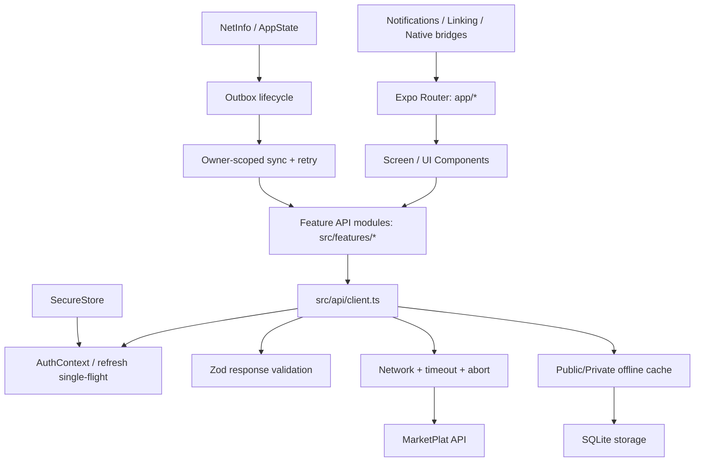

# تقرير التدقيق الشامل لتطبيق MarketPlat Mobile

**التاريخ:** 2026-11-09  
**النطاق:** `apps/mobile` (Expo 58 / Expo Router / React Native 0.88 / TypeScript)  
**طريقة العمل:** مراجعة المصدر والإعدادات والاختبارات الموجودة، وتشغيل الاختبارات التي لا تحتاج تثبيت حزم أو جهاز. لم يتم الاتصال بخدمات الإنتاج.

## 1. ملخص تنفيذي

- تمت مراجعة **103 ملفات Route/Screen** ضمن `app/` و**218 ملفًا** ضمن `src/`.
- تم فحص API client، AuthContext، Session/SecureStore، SQLite والكاش، Outbox، Network/NetInfo، التنقل والروابط العميقة، الإشعارات، القوائم، إعدادات Expo وAndroid.
- الإصلاح المؤكد والمنفذ في هذه الجولة: إزالة التكرار غير الضروري لحزمة `expo-build-properties` من `devDependencies`؛ الحزمة موجودة أصلًا في `dependencies` وتُستخدم كـ Expo config plugin. لم تتغير نسختها أو lockfile.
- لم أجد دليلًا كافيًا لتعديل منطق أعمال إضافي بأمان من مراجعة المصدر وحدها. لم تُجرَ تغييرات تجميلية أو تغييرات API غير لازمة.
- **لا يوجد APK ناتج عن هذه الجولة**، ولا يمكن اعتماد جاهزية Android/iOS للإصدار قبل بناء فعلي واختبار على جهاز.

## 2. خريطة التطبيق وتدفق البيانات

## 3. نتائج المجالات

### Authentication وSession

- `AuthContext` يربط استعادة الجلسة بتخزين الجلسة الآمن، ويتعامل مع دورة حياة التطبيق.
- API client يحتوي refresh single-flight لتجميع طلبات تجديد الجلسة المتزامنة، ويتيح تمرير CSRF عند إعادة المحاولة.
- توجد اختبارات منفصلة لـ refresh، session persistence/recovery، وpending logout.
- لا يمكن إثبات سلوك تدوير Refresh Cookie أو إبطال الجلسة مع API حي دون Integration Test على بيئة Staging.

### API Client وError Mapping

- `src/api/client.ts` يطبق مهلة افتراضية 10 ثوانٍ و120 ثانية للرفع، ويدعم AbortSignal.
- الاستجابات تمر عبر Zod response validation عند تزويد Schema.
- أخطاء الخادم تُطبّع إلى رسائل عربية، مع fallback للرسائل العامة/غير المفيدة.
- لا يظهر من الفحص وجود اعتماد حصري على `body.message`؛ هناك مسار مركزي لتطبيع الرسائل.
- يلزم اختبار تعاقدي حي لجميع رموز API، خصوصًا 401/403/409/422/429/5xx.

### Offline / SQLite / Outbox

- الكاش العام والخاص منفصلان؛ مفاتيح الكاش الخاص مرتبطة بمعرّف المالك، مع حصر صريح لمسارات GET المسموح تخزينها.
- الكاش المخزن يعاد التحقق منه باستخدام Response Schema عند توفره.
- توجد سياسات TTL وحدود عدد/حجم للصور والكاش، وسياسات لحماية العناصر المثبتة للاستخدام دون اتصال.
- Outbox يستخدم سياسة حالة/محاولات/تأجيل، ويدعم حدود المحاولات وIdempotency keys، كما توجد اختبارات دورة حياة ومزامنة.
- اختبارات Node للسياسات والتخزين نجحت (40/40). اختبارات SQLite الفعلية التي تحتاج Vitest/Expo SQLite لم تُشغّل.
- يلزم اختبار قتل التطبيق أثناء إرسال mutation، وتبديل الحساب أثناء وجود عناصر Outbox، وانقطاع الشبكة بعد قبول الخادم وقبل استلام الرد.

### Navigation / Deep Linking

- `app/_layout.tsx` هو نقطة تركيب التنقل العامة.
- توجد اختبارات لسياسة التنقل، الروابط العميقة، مشاركة المحتوى، ووجهات الإشعارات.
- إعداد Expo يشتق App Link host من `EXPO_PUBLIC_WEB_URL` مع fallback معروف، ويكوّن intent filters.
- فحص المصدر لا يثبت استلام الروابط من Android App Links أو iOS Universal Links بعد التثبيت؛ يجب اختبار روابط HTTPS على أجهزة فعلية مع ملفي assetlinks وapple-app-site-association.

### Lists / Performance / Lifecycle

- توجد أداة مشتركة `usePaginatedList` مستخدمة في شاشات الطلبات والمبيعات والعملاء والإشعارات والديون وغيرها.
- توجد معالجة لإلغاء الطلبات القديمة عبر AbortController، ومنع تكرار تحميل الصفحة، وإعادة محاولة append عند الفشل.
- تدفق المحادثات يستخدم آلية Live Stream مع fallback polling؛ يجب قياس استهلاك البطارية والبيانات على شبكة ضعيفة وفي الخلفية.
- تمت مراجعة مواضع Event Listeners وTimers؛ توجد cleanup patterns في الجسور والـ hooks التي تمت مراجعتها. لا يمكن الجزم بعدم وجود تسربات دون جلسة Profiler طويلة على الجهاز.

### RTL / Arabic / Accessibility

- توجد مكونات تصميم مشتركة وDesign Tokens وفحوص آلية للـ accessibility وعدم استخدام ألوان hex عشوائية.
- فحص التصميم الثابت نجح، لكنه لا يثبت حجم Touch Targets أو VoiceOver/TalkBack أو تكبير الخط على أجهزة حقيقية.
- يلزم اختبار RTL بصريًا على أحجام شاشات ونسب تكبير مختلفة.

### Media / Notifications / External Links

- توجد وحدات مستقلة للصور والملفات ومشاركة المحتوى والإشعارات والصوت.
- توجد إدارة Lifecycle لإشعارات Push وتحديثات الحالة.
- يجب اختبار أذونات الإشعارات، فتح الإشعار والتوجيه للشاشة الصحيحة، اختيار ملفات كبيرة، استئناف التنزيل، وفتح الروابط على Android/iOS.

## 4. إصلاح منفذ

| الملف | المشكلة المؤكدة | التعديل |
|---|---|---|
| `package.json` | `expo-build-properties` مكرر في `dependencies` و`devDependencies` رغم أنه Plugin/اعتماد وقت إعداد Expo وموجود بالفعل ضمن dependencies وضمن pnpm importer هناك | إزالة النسخة المكررة من `devDependencies` فقط؛ لا تغيير للإصدار أو lockfile |

التحقق بعد الإصلاح: `node scripts/verify-phase2-build-config.mjs` نجح.

## 5. نتائج الاختبارات المنفذة

| الاختبار | النتيجة | حدود الإثبات |
|---|---:|---|
| `node --test src/storage/__tests__/*.test.mjs` | **40/40 ناجح** | اختبارات Node لسياسات التخزين/Outbox/cache؛ لا تشغّل Expo SQLite Native |
| `node scripts/verify-release-config.mjs` | ناجح | تحقق ساكن من إعداد التوقيع فقط؛ لا يوقّع APK |
| `node scripts/verify-phase2-build-config.mjs` بعد الإصلاح | ناجح | تحقق ساكن من توافق manifest والـ lockfile وإعدادات البناء |
| `node scripts/run-all-verifications.mjs` | **68/70 ناجح** | الفحوص Script-based وليست E2E؛ فشلان موضحان أدناه |
| `npm run type-check` | لم يكتمل | غياب `expo/tsconfig.base` واعتماد TypeScript غير المثبت؛ كما ظهر اختلاف خيار `ignoreDeprecations` مع المترجم المتاح |
| Vitest (43 ملف اختبار) | لم يُشغّل | `node_modules` غير موجودة |
| ESLint | لم يُشغّل | `node_modules` غير موجودة |
| Android Gradle APK | لم يُشغّل | Android SDK غير متاح (`ANDROID_HOME` و`ANDROID_SDK_ROOT` غير مضبوطين) |
| iOS build | لم يُشغّل | لا توجد بيئة Xcode/macOS |

### الفشلان في فحوص Script-based

1. `verify-appointment-booking-ux.mjs`: يتوقع النص `load(true, accountChanged)` حرفيًا، بينما التنفيذ الحالي يستخدم `loadRef.current(true, accountChanged)` بعد تحديث مرجع أحدث loader. هذا اختلاف في صياغة الاستدعاء، وليس دليلًا على غياب إعادة التحميل عند تبديل الحساب.
2. `verify-mobile-unification-round3.mjs`: يتوقع `list.refresh()` مباشرة داخل شاشة المبيعات، بينما الشاشة تحفظه في `refreshList` وتستدعي `refreshList()` ضمن `refreshAll`. فشل الاختبار لا يثبت غياب التحديث.

لم أعدّل هذين الاختبارين لتجنب تحويل فحوص Regex إلى إثبات زائف لصحة السلوك.

## 6. سجل الشاشات

تم حصر جميع ملفات الشاشات/المسارات الـ103 التالية. فحص المصدر لكل ملف لا يعادل اختبار رحلة المستخدم على الجهاز؛ لذلك حالة التحقق التشغيلي لكل شاشة هي **تحتاج E2E/جهاز** ما لم يذكر تقرير الاختبارات أعلاه وجود اختبار وحدة يغطي منطقًا فرعيًا منها.

### التطبيق والتنقل والحساب

- `app/_layout.tsx`
- `app/index.tsx`
- `app/account.tsx`
- `app/profile.tsx`
- `app/profile/[id].tsx`
- `app/profile/[id]/followers.tsx`
- `app/profile/[id]/following.tsx`
- `app/settings.tsx`
- `app/sessions.tsx`
- `app/complete-profile.tsx`
- `app/delete-account.tsx`
- `app/blocked-users.tsx`
- `app/login.tsx`
- `app/register.tsx`
- `app/forgot-password.tsx`
- `app/reset-password.tsx`
- `app/verify-email.tsx`

### الإعلانات والاكتشاف والبحث

- `app/ads.tsx`
- `app/ads/[id].tsx`
- `app/ad-editor.tsx`
- `app/add.tsx`
- `app/my-ads.tsx`
- `app/categories.tsx`
- `app/categories/[id].tsx`
- `app/explore.tsx`
- `app/for-you.tsx`
- `app/favorites.tsx`
- `app/search.tsx`
- `app/promoted.tsx`
- `app/sellers-ranking.tsx`
- `app/suggestions.tsx`
- `app/trending.tsx`
- `app/following-feed.tsx`
- `app/following.tsx`

### المنتجات والمتاجر

- `app/products.tsx`
- `app/products/[id].tsx`
- `app/product-categories.tsx`
- `app/product-editor.tsx`
- `app/my-products.tsx`
- `app/stores.tsx`
- `app/stores/[id].tsx`
- `app/my-store.tsx`
- `app/my-stores.tsx`
- `app/my-store-analytics.tsx`
- `app/store/[slug]/stats.tsx`
- `app/store-collections.tsx`
- `app/store-collections-public.tsx`
- `app/collections/[id].tsx`
- `app/store-hours.tsx`
- `app/store-invites.tsx`
- `app/store-promotions.tsx`
- `app/store-team.tsx`
- `app/followed-stores.tsx`

### الخدمات والمواعيد والطلبات

- `app/services.tsx`
- `app/services/[id].tsx`
- `app/service-types.tsx`
- `app/service-providers.tsx`
- `app/service-providers/[id].tsx`
- `app/service-provider-profile.tsx`
- `app/service-provider-hours.tsx`
- `app/service-provider-analytics.tsx`
- `app/service-editor.tsx`
- `app/service-images.tsx`
- `app/service-requests.tsx`
- `app/service-requests/[id].tsx`
- `app/service-reviews.tsx`
- `app/appointment-create.tsx`
- `app/appointments.tsx`
- `app/requests.tsx`
- `app/requests/[id].tsx`
- `app/request-create.tsx`
- `app/my-requests.tsx`
- `app/my-services.tsx`
- `app/my-offers.tsx`

### التجارة والمبيعات

- `app/orders.tsx`
- `app/orders/[id].tsx`
- `app/order-checkout.tsx`
- `app/order-confirmation.tsx`
- `app/seller-orders.tsx`
- `app/seller-dashboard.tsx`
- `app/seller-profile.tsx`
- `app/sale-create.tsx`
- `app/sales/[id].tsx`
- `app/sales/[id]/receipt.tsx`
- `app/my-sales.tsx`
- `app/debts.tsx`
- `app/installments.tsx`
- `app/customers.tsx`
- `app/saved-payments.tsx`

### التواصل والإشعارات والمحتوى

- `app/messages.tsx`
- `app/messages/[id].tsx`
- `app/notifications.tsx`
- `app/activity.tsx`
- `app/stories.tsx`
- `app/stories/[id].tsx`
- `app/story-create.tsx`
- `app/shared.tsx`
- `app/report/[targetType]/[targetId].tsx`
- `app/my-reports.tsx`

### التخزين والعمل دون اتصال

- `app/offline-queue.tsx`
- `app/saved-offline.tsx`
- `app/storage.tsx`
- `app/saved-searches.tsx`

## 7. ملفات ومكونات تحتاج متابعة تشغيلية

- `src/api/client.ts`
- `src/features/auth/AuthContext.tsx`
- `src/storage/*` و`src/storage/outbox-sync-lifecycle.ts`
- `src/hooks/usePaginatedList.ts`
- `src/features/messaging/useChatLiveStream.ts`
- `src/features/notifications/NativePushLifecycleBridge.tsx`
- `src/lib/connectivity.tsx`
- `app/_layout.tsx`
- `app/messages/[id].tsx`

## 8. المخاطر المتبقية وخطة الإغلاق

1. تثبيت dependencies من جذر monorepo باستخدام `pnpm install --frozen-lockfile` في بيئة ذات اتصال موثوق، ثم `pnpm --filter @marketplat/mobile type-check` و`lint` و`test`.
2. تشغيل Vitest على الملفات الـ43، مع إضافة اختبارات تكامل Native لـ SecureStore وSQLite؛ لا تكفي mocks لاختبار SQLCipher فعليًا.
3. بناء Debug APK على Android SDK مطابق، تثبيته على جهاز Android، واختبار التسجيل والدخول واستعادة الجلسة والتنقل والرفع والإشعارات وOffline/Outbox.
4. اختبار Android App Links وPush Notifications بعد تثبيت التطبيق من حزمة موقعة.
5. تنفيذ iOS build واختبارات TestFlight/Simulator على macOS؛ غير متاح في بيئة التدقيق.
6. تنفيذ E2E بـ Maestro/Detox على مسارات حرجة، خصوصًا Checkout، الطلبات، المحادثات، وإعادة المزامنة بعد الانقطاع.
7. قياس الذاكرة والبطارية والبيانات في جلسة محادثة طويلة، وفي وضع الخلفية، وعلى شبكة 3G/ضعيفة.
8. Production signing يتطلب Keystore خاصًا وأسرار CI؛ لا تُضمّن أي مفاتيح أو كلمات مرور داخل الأرشيف.

## 9. حكم الجاهزية

**الحالة: غير معتمد للإصدار الإنتاجي بعد.**  
الشفرة اجتازت 40 اختبار Node و68 من 70 فحصًا ساكنًا نشطًا، لكن TypeScript وESLint و43 مجموعة Vitest وبناء APK وE2E واختبارات الأجهزة لم تكتمل. يجب عدم تفسير نجاح الفحوص الساكنة على أنه إثبات لاستقرار التطبيق على Android أو iOS.
